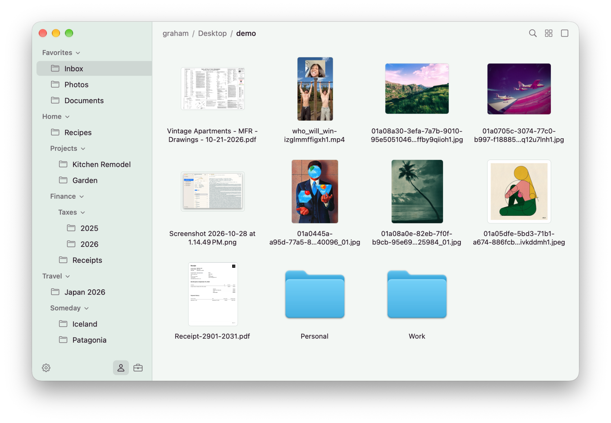

# Cubby

<p align="center">
  
</p>

Cubby is a fast, simple file manager for macOS, built to replace Finder for everyday browsing, organizing, and moving files. It opens folders with 100,000+ items in a fraction of a second, splits a window into up to four panes, and never writes `.DS_Store` or any other file into the folders you browse.

Learn more at [cubby.directory](https://cubby.directory).

## Install

```sh
brew install grahamotte/tap/cubby
```

Update with `brew upgrade`. To install by hand instead, download the latest zip from [Releases](https://github.com/grahamotte/Cubby/releases), unzip it, and move `Cubby.app` to `/Applications`. Builds are signed with a Developer ID and notarized by Apple.

Cubby requires macOS 27 or later.

## Using Cubby

### Browsing

The top bar shows the current folder as a breadcrumb; click any part of it to jump there. Beside it are **Filter** (⌘F), the view mode, and the pane layout.

- **Views**: list (⌘1), icons (⌘2), and columns (⌘3). The list view has sortable, resizable columns and folders that expand in place. The list and icon views show Quick Look thumbnails (⌘+ and ⌘− resize them), and Space opens Quick Look.
- **Layouts**: one pane, side by side, stacked, three panes, or four panes (⌥⌘1 to ⌥⌘5). Each pane browses on its own, so you can drag files between them.
- **Per-folder views**: each folder remembers its view, sort, and icon size. The memory follows a folder when it is renamed or moved. Each pane also remembers where you were scrolled in recently visited folders. Random sort (⌃⌘8) shuffles a folder in an order that stays put all day and changes the next day.

Copy, cut, paste, drag and drop, rename, duplicate, compress, new folder, and Move to Trash all work as in Finder, and ⌘Z undoes them. Hold ⌥ while dropping to copy instead of move. The Go menu has shortcuts to common folders and **Go to Folder…** (⇧⌘G).

### Sidebar

The sidebar holds your folders in groups, and groups can nest. Drag a folder between rows to add it, drag rows to reorder them, and drop files onto a sidebar folder to move them there (hold ⌥ to copy). Right-click for options such as adding or renaming a group.

**Profiles** give you separate sidebars and themes, such as Personal and Work. Add, rename, and pick an icon and color theme for each in Settings, and switch between them with the buttons at the bottom of the sidebar.

### Settings

Click the gear at the bottom of the sidebar (⌘,) to manage profiles and their themes, choose light, dark, or system appearance, whether to show hidden files (and, separately, `.DS_Store` files), and the default view for folders you haven't customized. **Keyboard shortcuts** in settings lists every shortcut.

Everything is stored as plain JSON in `~/.config/cubby`:

| Path | Contents |
| --- | --- |
| `config.json` | Settings and sidebar profiles, plus `terminal`, the app **Open in Terminal** uses. Edit it by hand with **Open Config File…**; Cubby reloads it as soon as it changes. |
| `themes/` | Extra color themes, one `.json` file each. |
| `folders.json` | Remembered per-folder views. |
| `session.json` | Open windows, layouts, and list columns. |

## Contributing

Issues welcome. Cubby is built on [Code Moto](https://github.com/grahamotte/CodeMoto); see [AGENTS.md](AGENTS.md) for development tasks and contribution rules.

## License

[MIT](LICENSE)
